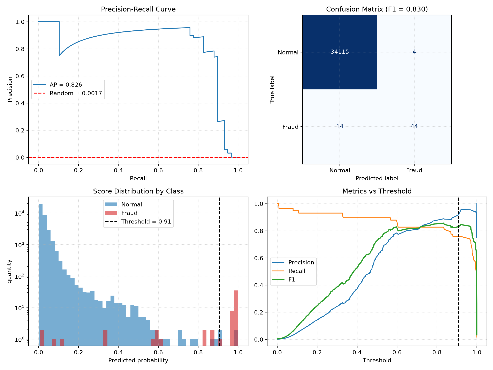

# Credit Card Fraud Detection

Fraud detection on the [Kaggle Credit Card Fraud dataset](https://www.kaggle.com/datasets/mlg-ulb/creditcardfraud) — an extremely imbalanced problem (**492 frauds out of 284,807 transactions, 0.17%**). The project is a modular, leakage-safe scikit-learn / imbalanced-learn pipeline with an MLP classifier, PR-AUC-based model selection, F1-optimized threshold tuning, and JSON experiment tracking.

## Dataset

284,807 credit card transactions made by European cardholders over two days. Features:

| Column | Description |
|--------|-------------|
| `Time` | Seconds elapsed since the first transaction in the dataset |
| `V1..V28` | Anonymized PCA components (already centered, decreasing variance) |
| `Amount` | Transaction amount (heavily right-skewed) |
| `Class` | Target: `1` = fraud, `0` = normal |

Only 492 transactions (0.172%) are fraudulent, which drives every design choice below (stratified splits, resampling, PR-AUC instead of accuracy).

## Results

Best experiment (`model4`), evaluated on a stratified hold-out split:

| Split | Average Precision (PR-AUC) | F1 |
|-------|:--------------------------:|:--:|
| Train | 0.750 | 0.812 |
| Val   | 0.797 | 0.845 |
| Test  | **0.826** | **0.830** |

Test confusion matrix (threshold = 0.90):

|                | Predicted Normal | Predicted Fraud |
|----------------|:----------------:|:---------------:|
| **Actual Normal** | 34,115 | 4 |
| **Actual Fraud**  | 14 | 44 |

→ Precision ≈ 0.92, Recall ≈ 0.76.



> A random classifier scores AP ≈ 0.0017 on this data (the fraud rate), so 0.83 is a large lift.

## Why these metrics?

With 99.83% normal transactions, accuracy is meaningless (predicting "normal" for everything gives 99.8%). The project uses:

- **Average Precision (PR-AUC)** — threshold-independent ranking quality, used for model selection (`GridSearchCV(scoring="average_precision")`) and reporting.
- **F1-score** — reported at a threshold chosen to maximize F1 on the validation set.
- **Precision / Recall / Confusion matrix** — to see the actual trade-off between missed fraud and false alarms.

## Approach

1. **Data split** — merge, shuffle, then a stratified 80 / 10 / 10 train / val / test split so every split keeps the fraud ratio.
2. **Feature engineering** — `Time` (seconds) → hour of day (one-hot); `Amount` → `log1p` + standard scaling; `V1..V28` (PCA components, already centered) passed through as-is.
3. **Imbalance handling** — `RandomUnderSampler(sampling_strategy=0.1)` inside the pipeline, so it is applied **only to the training folds** during cross-validation (no leakage).
4. **Model** — `MLPClassifier` (hidden layers `(64, 32)`, ReLU, Adam, early stopping), with `alpha` tuned by 4-fold stratified `GridSearchCV`.
5. **Threshold selection** — the decision threshold is the one maximizing F1 on the validation precision-recall curve (using `predict_proba` scores, not hard labels).
6. **Experiment tracking** — hyperparameters and metrics of every run are saved to `models/experiments.json`, and the fitted pipeline to `models/<name>.pkl`.

## Project Structure

```
├── data/                  # Raw Kaggle CSVs and the generated train/val/test splits
├── eda/
│   ├── generate_plot.py   # PR curve, confusion matrix, score distribution, metrics vs threshold
│   ├── evaluation_plot.png
│   ├── true.csv           # Ground-truth labels (test set)
│   └── pred.csv           # Predicted labels + probability scores (test set)
├── models/                # Saved pipelines (.pkl) and experiments.json
├── src/
│   ├── clean_data.py      # Loading, merging, shuffling, stratified splitting
│   ├── functions.py       # Utilities and metric evaluation (AP, F1)
│   ├── model.py           # Pipeline definition and grid search
│   ├── model_config.py    # Experiment tracking and model serialization
│   ├── predict.py         # Inference and evaluation on any split
│   ├── preprocessing.py   # Feature engineering transformers
│   └── train.py           # Training and threshold calibration
├── main.py                # Train → calibrate threshold → evaluate → save predictions
└── README.md
```

## Getting Started

```bash
pip install pandas numpy scikit-learn imbalanced-learn joblib matplotlib

# 1) Put the Kaggle CSV files under data/ (see src/clean_data.py for the expected folders)
python src/clean_data.py      # builds data/train.csv, data/val.csv, data/test.csv

# 2) Train, tune threshold, evaluate, save predictions
python main.py

# 3) Generate the evaluation figure
python eda/generate_plot.py
```

Hyperparameters live in the `model_params` dict at the top of `main.py`.

## Limitations & Next Steps

- **Small number of positives** — the val and test sets contain only ~58 frauds each, so the metrics are noisy (differences of a few AP points are not significant). Repeated stratified CV or bootstrap confidence intervals would give a more reliable estimate.
- **Random split** — in production, fraud is predicted on *future* transactions; a temporal split on `Time` would be more realistic.
- **Threshold tuned on validation** — validation F1 is therefore slightly optimistic; the test metrics are the unbiased ones.
- **Model comparison** — the MLP has not yet been benchmarked against Logistic Regression, Random Forest, and gradient boosting (XGBoost / LightGBM with `scale_pos_weight`), which typically perform strongly on tabular data like this.
- **Business-aware threshold** — a cost-based threshold (missed fraud costs the transaction `Amount`, a false alarm costs a manual review) would reflect real-world priorities better than F1.
- **Duplicates** — the dataset contains duplicate rows; removing them before splitting avoids train/test overlap.

## Author

**Mahamed Emad** — Machine Learning Engineer & Data Scientist · [Linkedin](https://www.linkedin.com/in/mahamed-emad/)
